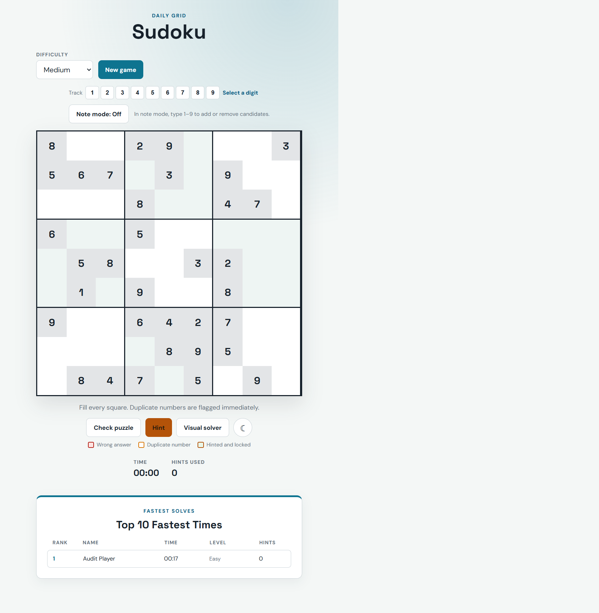
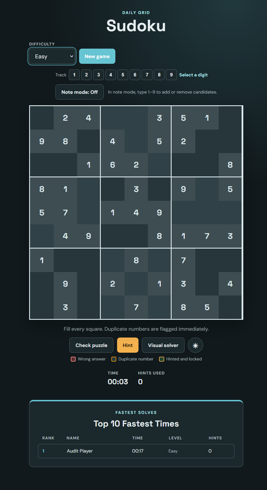
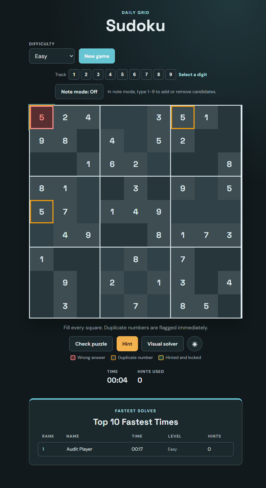
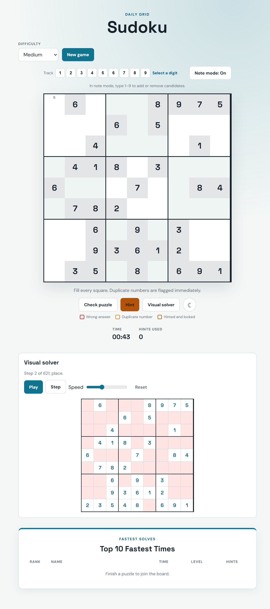
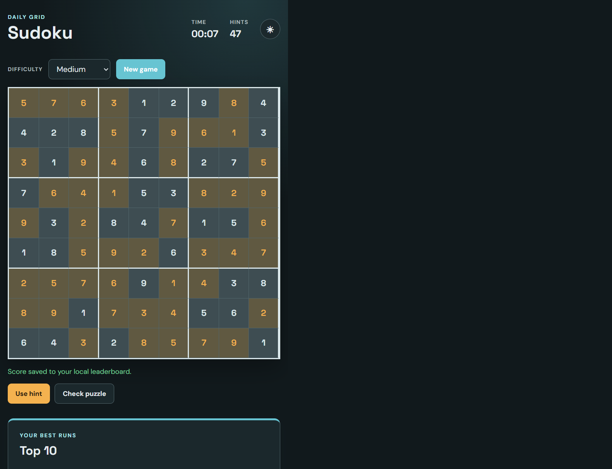
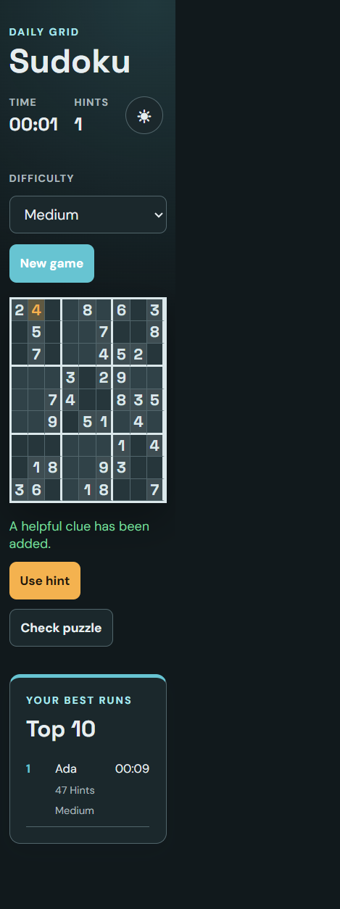
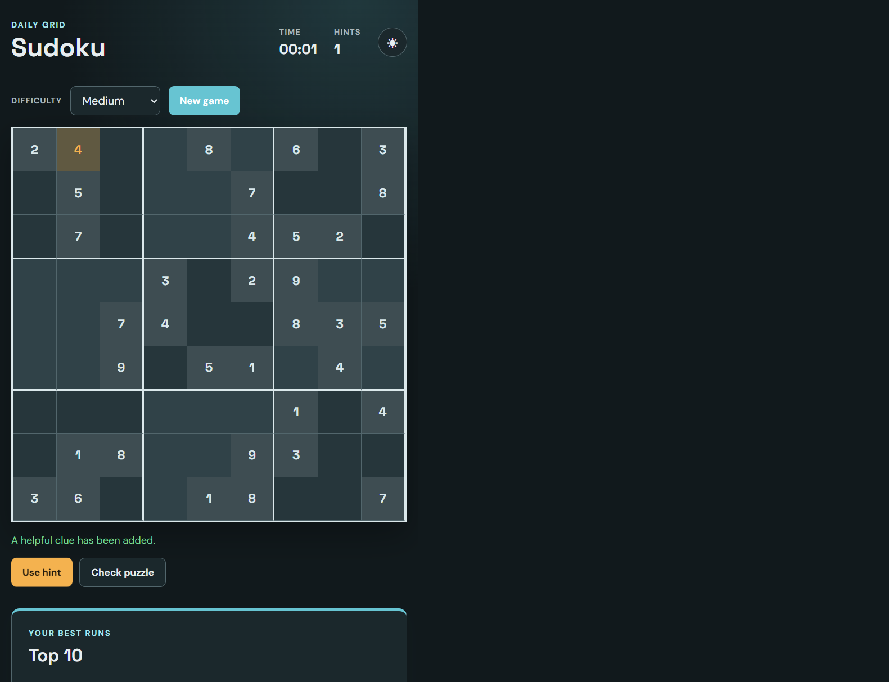
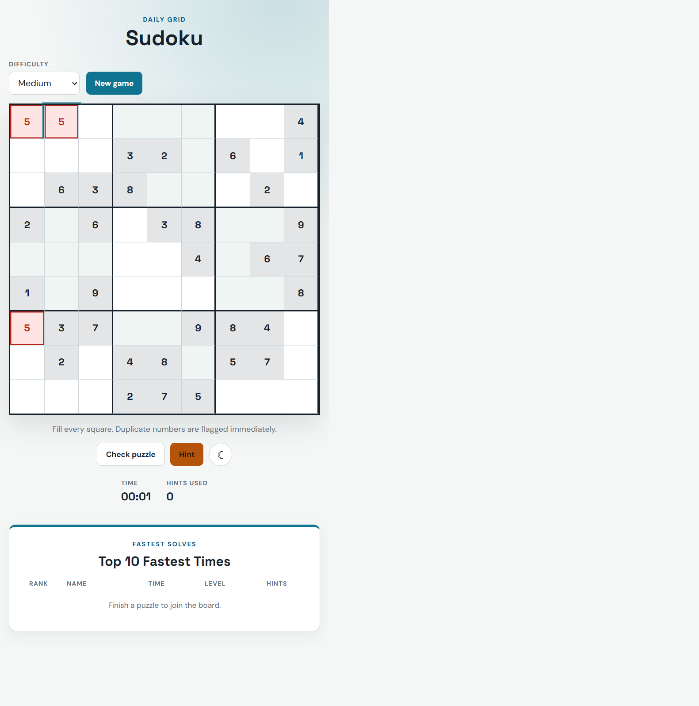
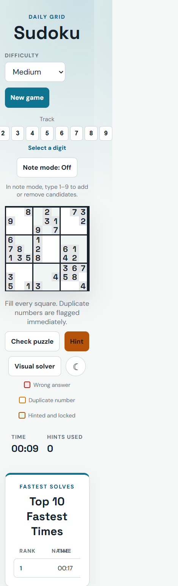

# Sudoku Flask Game

A responsive Flask and vanilla JavaScript Sudoku game with generated unique puzzles, hints, validation, notes, number tracking, a visual backtracking solver, themes, and a local leaderboard.

## Features

- Easy (42 clues), Medium (34), and Hard (28) puzzles with one solution.
- Locked original clues and permanently locked hinted cells.
- Immediate duplicate detection (orange borders) and wrong-answer detection (red fill, border, and text).
- Number tracking: select 1–9 to highlight occurrences and show `count of 9`.
- Note Mode: candidate digits are stored and rendered independently from answers.
- Visual solver: genuine backtracking trace with Play/Pause, Step, speed, and Reset; it never changes the player grid.
- Timer, hints, completion dialog, appreciation message, and validated local Top 10 leaderboard.
- Light/dark themes, responsive mobile layout, keyboard arrow navigation, visible focus, labels, live announcements, and non-color error text.

### Accessibility evidence

The practical audit measured rendered foreground/background colors in Chromium and calculated WCAG relative luminance ratios. Representative results are: light body `15.12:1`, light primary button `5.36:1`, light cell text `7.56:1`, dark body `15.16:1`, dark primary button `7.56:1`, and dark cell text `10.34:1`. The dark primary button was adjusted after measurement because the previous cyan background was only `2.02:1` with white text. Browser checks covered keyboard focus, arrow navigation, labels, live status regions, reduced-motion CSS, responsive sizes, and console errors. Formal certification and manual NVDA/JAWS/VoiceOver testing are not claimed.

## Technologies and installation

Python 3.12+, Flask, pytest, HTML, CSS, and browser-native JavaScript are used. No frontend build step is required.

```powershell
cd starter
py -3 -m venv .venv
.venv\Scripts\Activate.ps1
python -m pip install -r requirements.txt
.venv\Scripts\python.exe app.py
```

Open `http://127.0.0.1:5000`.

## Testing

From `starter`:

```powershell
.venv\Scripts\python.exe -m pytest -q
python -m json.tool ..\prompts.json
python -m py_compile app.py sudoku_logic.py
```

## Structure

- `starter/app.py` — Flask routes and locked-game state.
- `starter/sudoku_logic.py` — generation, solving, and uniqueness.
- `starter/templates/index.html` — accessible page structure.
- `starter/static/main.js` — board, tracking, notes, solver, timer, themes, and leaderboard.
- `starter/static/styles.css` — responsive light/dark styling and state indicators.
- `starter/test_app.py` — backend and frontend contract tests.
- `prompts.json` — reusable Copilot prompts for development, debugging, testing, UI, accessibility, security, and review.
- `RUBRIC_AUDIT.md` — requirement audit and verification boundaries.

## Screenshots

Existing genuine captures are in [`Screenshots/`](Screenshots/), including the new browser captures:












Additional evidence files include `difficulty-selector.png`, `hinted-cell-green.png`, `wrong-answer-red.png`, `duplicate-conflict-border.png`, `timer-running.png`, `incomplete-puzzle-feedback.png`, `leaderboard.png`, `successful-completion.png`, `keyboard-focus.png`, `accessibility-controls.png`, and `accessibility-contrast-evidence.png`. `final-tests.png` and a historical Copilot conversation capture were unavailable; no evidence was fabricated.

A live GitHub Copilot conversation capture was not available, so none is fabricated.

## Known limitations

Game state is in process memory and is not shared across users. Leaderboard data is local to the browser. Notes are intentionally client-side and are cleared when starting a new game. Full WCAG certification, assistive-technology testing, and live Copilot-process screenshots require manual testing with the target browser and tools.
